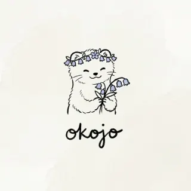

  <strong>Language:</strong>
  日本語
  |
  <a href="./README.en.md">English</a>

  

  <h2>
    こんにちは、<a href="https://okojo-it.com">okojo（オコジョ）</a>です 
    個人開発エンジニア • iOS • Android • Web
  </h2>
  <h4>日常の「小さな手間」を減らすアプリを作り、実装判断と失敗した条件まで記録しています</h4>
  Swift / SwiftUI • Kotlin / Jetpack Compose • Flutter • JavaScript • Python • Canvas / SVG / WebGL • ESP32

    

  
  
  
  
  
  

   

  

  

  <a href="#profile">Profile</a> ·
  <a href="#now">Now</a> ·
  <a href="#apps">Apps</a> ·
  <a href="#projects">Projects</a> ·
  <a href="#articles">Articles</a> ·
  <a href="#stack">Stack</a> ·
  <a href="#policy">Policy</a>

  

## プロフィール

個人開発エンジニアとして、日常で何度も発生する小さな手間を減らすための Web アプリや iOS アプリを作っています。以前は身近な人から相談された課題に合わせて個別に作ることが多く、現在はその経験をもとに、同じ困りごとを持つ人がそのまま使える形へ整理して公開しています。

- **作るもの:** iOS・Android・Web アプリ、ブラウザツール、WebXR、Stack-chan などの組み込み連携
- **大事にしていること:** なぜ作ったのか、データをどこで扱うのか、既知の制約は何かまで公開し、使う前に判断できる情報を置くこと
- **検証スタイル:** 公開リポジトリ・実装ファイル・動作確認の結果を根拠にし、未検証の内容はその状態が分かるように書く

**Website:** [okojo-it.com](https://okojo-it.com)  
**Contact:** [お問い合わせフォーム](https://forms.gle/1sVk1MEwX8diGxSo9)

  

## いま比較・検証していること

| テーマ | 領域 | 内容 |
|--------|------|------|
| **span の欠損・重複を件数で追う** | OpenTelemetry / Swift | 停止・再試行・background 遷移・256KiB 付近の境界を 75 回実行し、1,142 ファイルの証跡と照合。→ [otel-ios-reliability-lab](https://github.com/siu01/otel-ios-reliability-lab) |
| **1 枚絵を 1,130 パーツへ分解する** | JavaScript / SVG | 背景除去、Lab 色空間での減色、輪郭のベジェ化、線画のストローク化までを自作パイプラインで検証。 |
| **完全一致と動かしやすさを比較する** | Canvas / DOM / MediaPipe | SVG 分解、RGB の 1px 複製、Canvas 顔追跡、DOM/CSS、Stack-chan の描画方式を同じ観点で比較。 |
| **サマターゲを机の上へ出す** | Stack-chan / ESP32 | 既存機能を保ったまま、キャラクターの顔、ローカル発話検出、エアコンの赤外線操作を追加。 |

  

## 公開中のアプリ

| アプリ | プラットフォーム | 概要 |
|--------|------------------|------|
| [Uni-Log](https://apps.apple.com/jp/app/uni-log/id6761769414) | iOS / Web | 時間割・単位計算・タスク・出欠管理をひとつにまとめた、大学生のための管理ツール |
| [Aeon](https://apps.apple.com/us/app/aeon/id6780932128) | iOS | キーフレーム・レイヤー・エフェクトで、iPhone だけでモーショングラフィックスを制作できるビデオエディタ |
| [サマタゲ・サマターゲ](https://apps.apple.com/jp/app/%E3%82%B5%E3%83%9E%E3%82%BF%E3%82%B1-%E3%82%B5%E3%83%9E%E3%82%BF%E3%83%BC%E3%82%B1/id6761189957) | iOS | 25 分の集中と 5 分の休憩を、黒い化けものが見守るポモドーロタイマー |
| [1g あたり](https://apps.apple.com/us/app/1g%E3%81%82%E3%81%9F%E3%82%8A/id6774186093) | iOS | 食品や日用品の 1g・1ml あたりの単価を計算して比べられる買い物支援アプリ |
| [公務員の被扶養者のためのアプリ](https://apps.apple.com/jp/app/%E5%85%AC%E5%8B%99%E5%93%A1%E3%81%AE%E8%A2%AB%E6%89%B6%E9%A4%8A%E8%80%85%E3%81%AE%E3%81%9F%E3%82%81%E3%81%AE%E7%B5%A6%E4%B8%8E%E7%AE%A1%E7%90%86/id6762522578) | iOS | 勤務条件とシフトから給与を概算し、収入目標と比較できる管理アプリ |
| [Mvmt](https://apps.apple.com/jp/app/mvmt/id6765678909) | iOS | MP3 などの音声ファイルを保存・整理・再生できるシンプルなミュージックプレイヤー |
| [降り忘れ忘れくん](https://apps.apple.com/jp/app/%E9%99%8D%E3%82%8A%E5%BF%98%E3%82%8C%E5%BF%98%E3%82%8C%E3%81%8F%E3%82%93/id6770521236) | iOS | 登録した駅に着くと位置情報で通知してくれる、降り忘れ防止アプリ |
| [Air-keyboard](https://okojo-it.com/apps/air-keyboard/) | Three.js / WebXR | Meta Quest のコントローラーとフリックでかな入力できる空間キーボード |
| [High Quality Random RandInt](https://okojo-it.com/apps/high-quality-random/) | Web | Web Crypto API・BigInt・棄却法で、剰余の偏りなく整数を生成するツール |
| [CopyPaste](https://okojo-it.com/apps/copy-paste/) | Web | 複数のテキストボックスの内容をワンタップでコピーできるコピペ支援アプリ |

  

## GitHub のプロジェクト

| プロジェクト | 内容 | 技術 |
|--------------|------|------|
| [OTel iOS Reliability Lab](https://github.com/siu01/otel-ios-reliability-lab) | iOS アプリが不安定なネットワークやライフサイクル下で OpenTelemetry span をどれだけ確実に届けられるかを、証跡ベースで計測するラボ（E000–E021） | Swift, OpenTelemetry |
| VR Blender Link | Blender の 3D シーンに Meta Quest で入り込み、オブジェクト操作からキーフレーム再生まで双方向リアルタイム同期で行う空間型制作インターフェース | Python, Blender, VR |
| 3D GARDEN | ハンドトラッキングで手を突き出すと魔法が出る、Meta Quest ブラウザ向け WebXR アクションゲーム | Three.js, WebXR |
| サマターゲ Web デモ | 目標達成を促すコーチアプリ「サマターゲ」の、ゼロ依存で動く Web 版デモ | HTML, CSS, ES Modules |
| Voxel Builder | ライブラリ不使用、Canvas 2D の擬似 3D（アイソメトリック）ボクセル建築ツール | JavaScript, Canvas |
| MCP Safety Lab | 架空の MCP ツール定義を静的解析し、危険な操作の兆候を警告する教育用デモ | JavaScript |

  

## 最近の記事

- [OpenTelemetry Swift の配送信頼性を検証する](https://okojo-it.com/article-otel-ios-reliability-lab.html)
- [1 枚のイラストを JavaScript でベクター分解する](https://okojo-it.com/article-js-illustration-vectorize.html)
- [サマターゲを Stack-chan へ載せる](https://okojo-it.com/article-samatage-stackchan.html)
- [DUNS ナンバーの取得にかかった時間の話](https://okojo-it.com/article-duns-number-time.html)
- [実務で使う Git コマンド集](https://okojo-it.com/article-git-commands.html)
- [「完璧な AItuber」を作りたい](https://okojo-it.com/article-aituber.html)

→ [すべての記事を見る](https://okojo-it.com/articles.html) / [Zenn](https://zenn.dev/okojo_it) / [note](https://note.com/okojo_it)

  

## 技術スタック

**Mobile:** Swift / SwiftUI, Kotlin / Jetpack Compose, Flutter  
**Web / Graphics:** JavaScript, HTML / CSS, Canvas, SVG, WebGL, Three.js, WebXR  
**Observability:** OpenTelemetry Swift  
**ML / Vision:** MediaPipe（顔追跡）  
**Embedded:** ESP32, Stack-chan, 赤外線制御  
**Others:** Python, Blender, Git

  

## 開発ポリシー

- **小さく決めてから作る:** 対象ユーザー・入力してもらう情報・通知のタイミング・「使わない機能」を先に決める
- **データはなるべく端末内に:** 収入・位置情報・学業予定など、小さくても個人性の高い情報はローカルファーストで扱う
- **判断できる状態になってから公開:** 未完成ページを大量に出さず、利用者が判断できる情報量になってから公開する

---

  詳しくは <a href="https://okojo-it.com">okojo-it.com</a> へ · 2026

